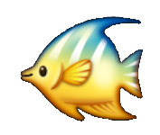
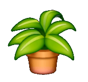

# Fish & Plant Tycoon Fix Patcher

 

🪴 Created with Codex AI, with contributions from Claude AI. Made with love by Lorsieab2 :) 🐟

An offline Windows patcher combining the current Fish Tycoon Fix Patcher and
Plant Tycoon Fix Patcher in the same player-facing format as the Virtual
Villagers Fun Patcher.

Current release: **v1.0.17**. See [CHANGELOG.md](CHANGELOG.md) for what each
version changed.

## Supported copies

Only the free Windows downloads from LDW's own site, <https://ldw.com>, are
supported. Every LDW PC game is free there, so there is no reason to source the
games anywhere else. Each engine is pinned to one exact executable identity, and
builds from any other distribution have not been checked against those pins, so
the patcher will refuse them rather than guess.

## Requirements

Windows, and Python 3 with Tkinter (the standard python.org installer includes
it). The launcher uses `py -3` when the Python launcher is present and falls
back to `python`. Nothing else is installed or downloaded, and the patcher
never needs the internet.

## Included fixes

### Fish Tycoon

- Fix Vanilla Bugs (on by default): the Plant of Incubation and Plant of
  Nutrition store labels are swapped back, so each plant is named for what
  it does.
- Crimson Comet 20% curing fix.
- Unknown Chemical: 3 uses.
- Universal supply slots 2-4 for the eight supported medicine, chemical, and
  egg types.
- Buy Multiple Golden Seahorses. Allows purchasing of multiple Golden
  Seahorses, in case you trash or lose it somehow. It shipped broken from
  v1.0.6 and was fixed in v1.0.12; see
  [docs/golden-seahorse-defects.md](docs/golden-seahorse-defects.md).
- Bigger tanks: 26 fish (off by default). Every tank holds 26 fish instead of
  21. The game's save already has room for them, so saves keep their layout.
  Sell or move fish down to 21 per tank before turning it off again. Design:
  [docs/fish-tycoon-tank-expansion.md](docs/fish-tycoon-tank-expansion.md).
- DS Exclusive Fish (off by default). Adds the Nintendo DS version's seven
  extra bodies (Clownfish, Discus, Bicolor, Trigger, Surgeonfish, Tang, Idle)
  and seven extra fins (Small Fin, Roundy, Angel, Clown, Yellow, Blue,
  Moorish): 343 new species. Eggs, the store and two PC parents never give
  them. The Unknown Chemical, and the Magic Fish of Mutation at hatching, can
  step a Spotanus body or Twin-Fin fin one place further into them, with the
  same odds as before. Breeding a DS fish, prices, rarity, names and fin
  placement follow the DS game. It runs as a companion DLL the game loads at
  start (`Fish Tycoon Fix Patcher DLLs\DS Exclusive Fish.dll`), its sprites go
  in `Images`, and each save slot keeps its DS species data in
  `Fish Tycoon Fix Patcher Data\DS Fish <slot>.dat` beside the saves; the
  save files themselves keep their stock layout. How to get each one:
  [docs/fish-tycoon-ds-fish-testing-guide.md](docs/fish-tycoon-ds-fish-testing-guide.md);
  every address it uses:
  [docs/fish-tycoon-ds-fish-technical-map.md](docs/fish-tycoon-ds-fish-technical-map.md).
  Sell or trash every DS fish before turning it off again.
- DS Store Items (off by default; needs DS Exclusive Fish, which it turns on
  with it). An Upgrades button in the Supplies store opens the DS version's
  store items. The Puffer Fish, Sting Ray and Moray Eel ($1250 each) are tank
  companions like the Golden Seahorse: they swim, can be dragged between
  tanks, never age, breed or get sold, and magically enhance the life and
  environment of your fish (the Tools tab's Game Mechanics lists the exact
  effects). The Moray Eel comes with its rock: drop the eel on it to send it
  home, move the rock and the eel goes with it, and drag it out by its head.
  Trashing the eel trashes its rock, and the other way round. The animals,
  the Golden Seahorse included, never take a fish's place: each tank has 5
  animal slots of its own. Exotic Fish Eggs ($2300) hatch only the DS-exclusive bodies and fins.
  The Golden Seahorse keeps its PC effects and gains its DS one. It runs as a
  second companion DLL (`Fish Tycoon Fix Patcher DLLs\DS Store Items.dll`),
  loaded by DS Fish's; everything it adds is kept in the game's own save.
  Design and live checks:
  [docs/fish-tycoon-ds-store-items-design.md](docs/fish-tycoon-ds-store-items-design.md).
  Trash the store animals, and let the eel out of its rock, before turning it
  off again.

### Plant Tycoon

- No old-age plant deaths. The original age check and `Random(1000)` call remain;
  the eligible death range is empty.
- Add Missing Assets to LDW Version (on by default, new in v1.0.15). Adds
  files the LDW download is missing, using the Steam version's files. The merge
  is only additive: a file is copied into the modded folder only where the game
  lacks it, a game file is never replaced, and a bundled file identical to the
  game's own is ignored. Turn it off and patch again to get a folder without
  them. Against the supported LDW build it adds 15 sounds (birds, bell, bug
  sounds, butterfly, cricket loop, cross-breeding chimes and harp, gentle
  fountain, insect buzz, medical drip, wind in the trees and windchimes); 294
  bundled files are identical to the game's own and are ignored, and 7 that
  differ are left at the game's version.
- Add unused flowers (off by default). Fourteen flower heads ship in the game's art
  but no plant uses them; this adds them as new flowers: Nightingale, Rosetta,
  Lilac, Veronica, Violetta, Stella, Silvermist, Anagallis, Buttercup,
  Cerulean, Phalaena, Mirabilis, Indigoberry and Prunus. With the 23 foliages
  that is 322 new species, all in the rarest class.
  - Mutation Liquid can step a Tilia flower one place further, into the new
    ones, with the same odds.
  - Breeding mixes them by the game's own rule.
  - Mirabilis is recoloured golden so it isn't confused with Jalapa.
  - It runs as a companion DLL the game loads at start
    (`Plant Tycoon Fix Patcher DLLs\Unused Flowers.dll`). Each save slot
    keeps the new species' prices and discoveries in
    `Plant Tycoon Fix Patcher Data\New Flowers <slot>.dat` beside the saves.
  - Design:
    [docs/plant-tycoon-new-flowers-design.md](docs/plant-tycoon-new-flowers-design.md).
    Sell or compost the new flowers before turning it off again.
- Add new store upgrades and items (off by default; needs Add unused
  flowers). An Upgrades link on the bricks at the left of the Supplies store
  opens a second view of the store with only the new items, each where it
  would sit in the stock store:
  - Legendary Seeds on the seed shelves: three a day, $5000 each, any foliage
    with one of the new flowers (the stock packets keep their stock flowers).
  - Radioactive Plant Formula with the chemicals: $10,000, 3 doses; far
    beyond spamming Fertilizer Bombs and Plant Food: every branch grows (dead
    ones and the ones the plant's shape normally hides), the largest size,
    full bloom, a flower on every spot of every branch and leaf (hundreds on a
    big plant), no dead or brown leaves, full health, and 5 seeds when
    pollinated.
  - The Fourth, Fifth and Sixth Seed Box with the tool upgrades: $1000
    each, bought in order like the stock ones. Each opens a 40-seed drawer in
    a second chest; the gold arrows on the Seed Storage title bar switch
    between boxes 1-3 and 4-6, and the greenhouse fills boxes 4-6 once 1-3
    are full.
  - Click Supplies in the bottom bar to go back.
  - Design:
    [docs/plant-tycoon-upgrades-design.md](docs/plant-tycoon-upgrades-design.md).

## Use

1. Extract the release ZIP.
2. Double-click `Launch Fish and Plant Tycoon Fix Patcher.bat`.
3. Click **Find Both in Parent Folder...** and pick the folder your game
   folders sit in, or select each vanilla folder yourself.
4. Select **One Game** or **Both Games**.
5. Choose the fixes you want, using **Defaults**, **Enable All**, or
   **Disable All** if it is quicker.
6. Validate, dry run, or create the fixed copy/copies.

The GUI remembers separate vanilla and modded paths for both games. Every blue
underlined path is a direct File Explorer link to that folder.

### Finding your games

Point the patcher at the folder that holds your game folders and it fills in
the rest. **Find Both in Parent Folder...** looks for the exact
`Fish Tycoon.exe` and `Plant Tycoon.exe` in that folder and its immediate
subfolders, and fills in the vanilla and modded folder fields for both games.
**Find Fish Tycoon...** and **Find Plant Tycoon...** do the same for one game.
An exact match is required: a missing or ambiguous result is reported rather
than guessed at.

This only fills in a path. Whatever it finds still has to pass the exact
identity check below before anything is written.

### Where the modded copies go

Choose one parent location in the GUI. The patcher creates complete separate
output folders named `Fish Tycoon - Modded` and `Plant Tycoon - Modded`.
Their executables are named `Fish Tycoon - Modded.exe` and
`Plant Tycoon - Modded.exe`. Original folders and executables are not replaced.
With a setting that adds new content on (DS Exclusive Fish, DS Store Items,
Add unused flowers, Add new store upgrades and items), the copy is
`Fish Tycoon - Modded Upgrades` / `Plant Tycoon - Modded Upgrades` (folder and
EXE) instead, beside the plain copy; the game names its save folder after the
EXE, so it keeps its own saves.
The **One Game** tab also retains each original patcher's verified
restore-from-backup operation.

### Where your saves go

Both games build their save path as
`Documents\LDW\<exe name>\<game name><number>.ldw`. The folder comes from the
executable: the game reads its own file name with `GetModuleFileNameA` and drops
the path and `.exe`. The file names are the game's own fixed name, through the
`%s%d.ldw` format string each build carries.

So a modded copy gets a folder of its own, next to your original game's:

```
Documents\LDW\
    Fish Tycoon\               <- original game
        Fish Tycoon0.ldw        <- settings
        Fish Tycoon1.ldw ...    <- saves
    Fish Tycoon - Modded\      <- modded copy
        Fish Tycoon0.ldw        <- settings
        Fish Tycoon1.ldw ...    <- saves
```

The file names are the same in both folders, but the folders are separate, so
your original saves are never touched and the two builds cannot overwrite each
other. `Documents` is wherever Windows keeps it, which is often
`OneDrive\Documents`. Things that follow and are easy to be surprised by:

- File `0` holds settings rather than a save, and it lives in the per-executable
  folder too, so a modded copy starts with fresh settings instead of inheriting
  the ones from your original game.
- Renaming a modded executable changes which folder it uses. Rename it and its
  saves appear to vanish; they are still there in the folder named after the old
  executable.

## Tools

The **Tools** tab is laid out and works like the Virtual Villagers Fun
Patcher's: the tools for the game chosen on the One Game tab, then the same
tools for each game (Back up saves, Restore saves..., Rename players...,
Game mechanics...), and Back Up Saves (Both)... for both at once. Every tool
has a "?" guide. They work on the modded copies' save folders ("- Modded",
"- Modded Upgrades" and any other "<Game> - Modded..." folder; see "Where
your saves go"). Every file operation uses Windows' long-path form, so a deep
folder never fails with "path too long".

- **Backup and Restore Saves.** A backup is a copy of the save folder (the
  game's saves and the patcher's own per-player files) in a `Backups` folder
  inside it, named `Backup <date and time>`. Every copied file is read back
  and checked against the original's SHA-256 and keeps its times; a copy that
  fails is set aside as `INCOMPLETE` and never offered. If the game is
  running it is paused for the copy and resumed afterwards. Backups are
  listed newest first with the players they hold. A restore needs the game
  closed and puts back the whole folder, or one player slot (that player's
  save files, the patcher's files for that slot, and the slot's name in the
  player list); the saves as they are now are backed up first as
  `(before restore)`, so a restore can itself be undone. Zip backups made by
  v1.0.17 can be imported into the list.
- **Rename Player Slots.** Changes a player's name in the game's player list
  and inside that player's own save files, up to 31 plain characters as in the
  game, with the game closed. The save folder is backed up first, as
  `(before rename)`. A save file is changed only where
  it holds exactly the old name; anything else is left alone. The layouts are
  in `src/save_tools.py`.
- **Game Mechanics.** A read-only page, with a tab for each game, on how the
  games really work underneath, read from their code:
  - time away, health, food, sickness, pests, breeding, seeds, the store,
    research, selling, magic fish and plants, and bugs;
  - an index of every random roll and timer.

  Every chance is the game's own test with its exact odds (`Random(100) < 50`
  is 50.05%, not 50%). Each line is labelled VERIFIED-C, VERIFIED-E or
  UNCONFIRMED. A "With the patcher" line marks what one of this patcher's
  settings changes. It never touches a save, so the games can stay open. See
  [docs/game-mechanics-window.md](docs/game-mechanics-window.md).

## Safety

Each engine remains bound to the exact supported stock executable identity,
including SHA-256, size, PE fields, and resource-section hash. Every changed
byte is guarded, expected output hashes are pinned, backups are created, output
files are read back, and the original icon resources remain intact.

When both games are selected, both inputs are dry-run validated before either
output folder is written.

No game executable or save is included in this repository or release. The one
exception to shipping game files is `assets/plant_tycoon_steam/`: Plant Tycoon
files taken from the Steam version (316 sounds, images and other files), used
only to fill in what the LDW release is missing. LDW no longer updates the
games, so there is no other way for the LDW version to get them. Each is pinned by size and SHA-256 and refused if it does not match.

## What each patch does

Every setting in the GUI has a **Technical details** disclosure, collapsed by
default. For an executable fix it lists each byte-level change the setting
installs — virtual address, file offset, size, and what that change does. The
same note is written into the patch log next to each change, so a completed run
records not just what bytes moved but why. For Add Missing Assets it lists every
file the setting can add, and the patch log records each file as added,
identical and ignored, or kept at the game's version.
`docs/fish-tycoon-technical-details.md` and
`docs/plant-tycoon-technical-details.md` go further into the disassembly and the
asset merge.

## Tests

```
python tests/test_combined_patcher.py
```

The suite covers the exact executable identities, that every setting combination has a pinned output hash, the
game search, the GUI wiring, and the asset merge: additive only, identical files
ignored, tampered or outside bundles refused, and every bundled file stored by
git byte-for-byte against its pin. It uses synthetic fixtures and the bundled
assets only, so it needs no copy of either game.
