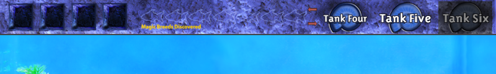
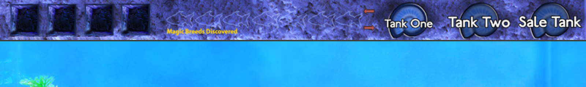

# Fish Tycoon: 3 extra tanks

Status: built ("Extra Tanks.dll", the "3 extra tanks" setting, off by default,
in the "Fish Tycoon - Modded Upgrades" copy). Checked in emulation against the
vanilla executable (`tests/test_extra_tanks.py`); not yet run in the game.

## What the player gets

**EXPERIMENTAL - USE AT OWN RISK** (the setting's label). The setting needs
DS Store Items, which it turns on: the tanks are sold on its Upgrades screen.

**Buying.** The Extra Tank item on the Upgrades screen (two net cells,
bottom right; the stock store's Second Tank picture, ITEM_TANK2.png, sprite
157) costs $10,000 ($0 with Free upgrades), asks the game's "Buy this item?",
and opens the next of Tank 4, 5 and 6; once all three are bought it
shows "This is in your inventory." and "You already own this!". DS Store
Items asks `Extra Tanks.dll` through two exports, `FtfpExtraTanksOwned` and
`FtfpExtraTanksBuy`; without that DLL the item is hidden. Until a tank is
bought its button is greyed (a fourth frame of its button art), a click or a
drop on it shows "You don't own this tank yet!" for 2 seconds in the hint
font at the mouse, as the game's hints are drawn (0x417E90), the fish swims
back, and the arrows skip it. The number bought is in the sidecar; a new game
resets it to none.

**Art.** Tank 4 looks like Tank 1, Tank 5 like Tank 2 and Tank 6
like the Sale Tank: the game draws a tank's background (0x41D140:
MAINTANK1/2/3_BG_PNG, sprites 27, 26, 25) and its own wood and plants
(0x41D340) by the tank number, so the DLL lends the number for those two calls
(and holds back the Sale Tank's one-time tutorial tip 0x1A). The Sale Tank's
"For Sale!" sign is not part of its background: it is `forsale.png` (sprite
4) drawn at (620, 360), with `TANK_OBJECT_SHADOW.png` (sprite 3) under it at
(580, 415), the last two draws of the Sale Tank's decorations (0x41D435,
0x41D44F). Both are skipped while an extra tank is drawn, so Tank 6 has no
sign.

Mockups with the name label and the For sale toggle, Off and On:
`docs/images/extra-tank-4-selling-off.png`, `extra-tank-4-selling-on.png`,
and the same for 5 and 6, and the Sale Tank (Tank 3) beside Tank 6 with For
sale On: `docs/images/tank-3-sale-vs-tank-6-for-sale-on.png`
(`scripts/render_extra_tanks_mockups.py`). Tank 6 with For sale On draws
exactly the Sale Tank's draw calls (background, wood, plants, snail, aerator,
heater, ornaments, sign and shadow); Tanks 4 and 5 exactly Tank 1's and Tank
2's: `tests/test_extra_tanks.py`, SameLookAsTheStockTank. Besides the
background and decorations, the snail (0x41D1B0), the aerator and heater with
the ornaments after them (0x41EE60, 0x41D600) and the aerator's bubbles
(0x416B90, 0x416BB0) are drawn with the tank's number and place lent.

Tank 4, Tank 5 and Tank 6: three more tanks exactly like Tank 1
and Tank 2. Fish live, age, eat, get sick, breed and give birth in them;
food, medicines, chemicals, eggs, ornaments, research, the plants, the
magic fish (the Wasp Grouper's mutation included), the Golden Seahorse and
the DS store animals work there as in any tank; "Bigger tanks" makes them 30
fish too (the game's own AddFish limit). They are reached from the tank screen's top bar: two small arrows
(the game's own UP_ARROW.png turned on its side, left above right) left of
the Tank 1 button page the three tank buttons from Tank 1 / Tank 2 /
Sale Tank to Tank 4 / Tank 5 / Tank 6 and back. Click a button to
look at that tank. Drag a fish, a DS store animal or an ornament onto a
button to move it to that tank, or onto an arrow to move it to the previous
(left) or next (right) tank in page order: Tank 1, Tank 2, the Sale
Tank, Tank 4, Tank 5, Tank 6, and round again. As on the stock
buttons, a full tank refuses it ("The tank is full!") and an unbought Tank
Two too ("You don't own a second tank yet!"); a young fish dropped into the
Sale Tank gets the stock tutorial tip. The stock buttons work as stock. The buttons are the stock button art with
the label written in the game's own font
(`font_triplex_sanslightlin_bold_16pt.png`), built by
`scripts/build_extra_tanks_assets.py`; the tank itself is the stock tank,
drawn with Tank 1's background.

With every "For sale" button Off only the Sale Tank sells, exactly as stock:
fish for sale, customers and the sale scene read tank 2, the Sale Tank, whose
size follows the tank size setting (21, 30 with Bigger tanks). An extra tank
with For sale On sells together with it (see Selling from the extra tanks
below), and the crowd still never passes the stock maximum.

## Phase 1: how many tanks the game has, and where that is fixed

Static analysis of the vanilla `Fish Tycoon.exe` (image base 0x400000).

### The state

* The game state (global pointer `0x45ABDC`) holds **four tank blocks of
  0x51EC bytes** at `state + 0x390 + tank * 0x51EC`: tank 0 Tank 1, 1 Tank
  Two (bought: `state + 0x230`), 2 the Sale Tank, 3 the isolation tank. A
  block is 31 fish records of 0x288 bytes (`+0`), 11 ornament records of 0x2C
  (`+0x4E7C`, 6 used), and 10 more records of 0x28 (`+0x5060`). The
  constructor `0x41A9A0` builds a block with zeros only, so an empty block is
  all zeros. Records hold no pointers (the sprite fields are ids).
* **The blocks end at `state + 0x14B40`, where the species table starts**
  (21 rows of 31 entries of 40 bytes, to `0x1B0F8`), followed by research,
  goals and the rest of the state up to the save's end at `state + 8 +
  0x1E3C8`. There is no room for a fifth block, and every tank access is a
  fixed `0x51EC` stride from `0x390`, so the count cannot be raised in place;
  relocating the state is not possible either (hundreds of fixed offsets past
  the tanks, e.g. `0x14B60`, `0x1E168`).
* The current tank is `state + 0x384` (0-2; the isolation tank is drawn into
  every view as an extra entry).

### The save

Save is the state's virtual `Save(slot)` (vtable `0x44249C`, slot `0x4424D4`
= `0x419100`); it writes `state + 8`, `0x1E3C8` bytes, as one record. Load is
slot `0x4424D0` = `0x41AE70`. Both are also called virtually from
`0x4190C0` (the autosave: slot 0, the slot, and the slot's backup at slot +
20), `0x41764C`, `0x41A85E`, `0x41ACBB`, `0x41AB37`-`0x41ABE1` (the player
list) and `0x41ACA6`-`0x41ADFA`, and directly at `0x41A663` (quitting). The
save has no spare room for three more blocks (84 KB), so **the extra tanks
live in a sidecar**: `Documents\LDW\<exe name>\Fish Tycoon Fix Patcher
Data\Extra Tanks <slot>.dat`, beside DS Fish's.

### Every loop over tanks

| What | Where | Tanks |
|---|---|---|
| The fish update (age, food, health, sickness, breeding, births, death, discoveries, magic fish) | `0x41FE70`: pass 1 `[esp+0x10]` 0..3 (`cmp eax, 3` at `0x4206C5`), pass 2 `edi` to `0xF5C4` (`0x42088F`); research after | 0-3 |
| New-game resets | `0x41A8F0` (REMOVE_FISH, tanks 0-2), `0x4198F0` (tanks 0-3), `0x4194A0`, `0x4194F0` | 0-3 |
| Starter-egg count ("any fish in tanks 0/1/2") | `0x41FC90` | 0-2 |
| Golden Seahorse purchase | `0x427E59`/`0x427E79`/`0x427E91`: AddFish to 0, else 1 (if bought), else 2 | 0-2 |
| Debug ages (`state + 0x1E168 == 9999`) | `0x423050` | 0-3 |
| Sale screen, customers, thoughts, sale scene | `0x423800`, `0x424240`, `0x413530`, `0x423E00` | 2 only |
| Tank buttons: draw, press, switch | `0x4216E0`, `0x421B80` (down), `0x421D4A`-`0x421EB4` (up: `state + 0x384 = t`, then `0x421940`) | 0-2 |
| Moving fish (drop on a button) | `0x41EFF0`: AddFish (`0x419C50`) into the button's tank, REMOVE_FISH (`0x418E20`) from the held fish's | 0-3 |
| Chemicals, medicines, food, eggs, ornaments, trash | the current tank, `state + 0x384`: 96 readers in `.text`, each an `imul 0x51EC` into the block, a choice of art or sound by tank number, or the tank buttons | current |

The view (the swimming fish) is built from the current tank's block
(`0x415340`, `0x415E70`) and holds `(tank, slot)` per entry.

### Per-tank data outside the blocks

None the game keeps: ornament counts for customers, owned items (Aeration,
Temperature Regulator, the snail, the four plants), research and the Golden
Seahorse are game-wide flags; the tank background (`0x41D140`) and the
ambient sounds are chosen from the current tank number at draw time.

## The approach: the game's own code on three more blocks

Raising the tank count is impossible (above), so the DLL keeps three more
blocks of the same layout and **lets the game's own code run on them**,
swapping blocks in and out of the four places the code knows. No tank
routine is rewritten:

* **On screen.** Clicking Tank 4/5/6 swaps that block into Tank
  One's place (and Tank 1's block into the DLL) and runs the game's own tank
  switch with the current tank 0. Everything the game does to the tank you
  are looking at -- drawing it, food, medicines, chemicals (stock, Unknown
  Chemical, Growth Hormone, Vitamins, and any later one that acts on the
  current tank), eggs, ornaments, the trash, breeding through the isolation
  tank -- therefore happens to the extra tank, by the stock code. Clicking any
  stock button puts Tank 1 back first.
* **Every fish update.** The two calls of the update (`0x4218FF`, every 301 s
  on the tank screen, and `0x421AAA`, when it opens or switches tank) are
  followed by one more run of the game's own update with the three held blocks
  in the places of tanks 0-2 and an empty block in the isolation tank's, then
  everything goes back. Each fish carries its own clock (`+0` last update,
  `+4` banked seconds), so the second run ages exactly the held fish, by
  exactly the time since their last update, with the stock rules: magic fish,
  the Wasp Grouper and DS store animals count in their own block, global
  upgrades are the same flags. The update's research part is driven by its
  own banked time, so the second run adds no research. An empty block rolls
  no dice. The isolation fish is updated once.
* **Moving fish.** A drop on an extra tank's button or an arrow: the game's
  own AddFish into that block (a held block is swapped into Tank 1's place
  for the call, the record copied first), REMOVE_FISH from the held fish's
  tank, as the stock drop (`0x41EFF0`), with "The tank is full!" at the
  game's own limit. DS store animals go to the target tank's own 5 animal
  records (DS Store Items' records for Tanks 1-3; for Tanks 4-6 the records
  this DLL keeps after each block), as DS Store Items moves them.
* **Moving ornaments.** As the stock ornament drop (`0x41F660`): the game's
  own placement (`0x419C00`, six per tank), lift (`0x41E980`), new place
  (`0x41E9C0`) and settle (`0x41EA10`), with a held block lent the place of a
  stock tank other than the one on screen for the calls.
* **Multiple ornaments** (PR #60): its DLL keeps decorative copies per tank
  0-7 and asks which tank a stock place shows; this DLL tells it
  (`FtfpOrnamentsSetTankMap`: Tank 1's place shows 3-5 while an extra tank
  is on screen), and loads "Multiple Ornaments.dll" first when it is there.
  A copy dropped on an arrow, an extra tank's button, or Tank 1's while an
  extra is on screen is handed to that DLL's own drop as a drop on the middle
  of a stock button whose tank the map names as the target for that one call
  (with no copy held, the stock release with nothing held does nothing).
* **Held items.** Food, medicines, chemicals and eggs on the cursor are not
  moved: they act on the tank on screen, and the switch to an extra tank is
  the game's own switch (`0x421940`), which puts a held item or ornament back
  (`0x421A4B`-`0x421A55`), as every stock switch does. Eggs hatch into the
  tank on screen, an extra tank too (the game's hatch uses the current tank).
* **Saves.** Before every `Save(slot)` of a game slot, Tank 1 goes back to
  its place, so the save is exactly what the stock game would write; after a
  successful save the three blocks are written to the sidecar (to a `.tmp`
  file, flushed, then moved over the old one) and the extra tank goes back
  on screen. `Load(slot)` reads the sidecar (magic, version, size, CRC-32);
  a missing file means empty extra tanks, an unreadable one is set aside as
  `.unreadable-N.dat`, never deleted. A new game empties them.

Why not a DLL-owned simulation: it would be a second implementation of the
update, which the owner ruled out ("run the game's own tank routines on the
extra tanks' data") and which could never be proven identical. Swapping
whole blocks makes every per-tank byte (fish, ornaments, the tail records)
follow its tank with no knowledge of what it means.

Safety: the save file is never touched by the DLL and keeps its stock
layout; the swaps are all inside one call each and are undone in a
`__finally`, so nothing can leave a block out of place; every hook site is
checked first and all are written or none (`install_sites.h`).

## Hooks (native/ftfp_extra_tanks/tank_sites.h)

| Site | Stock | What the DLL does |
|---|---|---|
| `0x4218FF` | `call 0x41FE70` | the update, then the held blocks' update |
| `0x421AAA` | `call 0x41FE70` (DS Store Items chains it first) | the same |
| `0x421FFB` | `call 0x421B80` (the tank screen's mouse) | the arrows (either turns the page); the extra buttons on their page; Tank 1 back before a stock button |
| `0x421D43` | `call 0x421B20` (a held fish let go) | a fish, animal or ornament dropped on an arrow, on an extra tank's button, or on Tank 1's while an extra is on screen |
| `0x42208E` | `jmp 0x4216E0` (the button overlay) | the arrows and the extra buttons, after the stock ones |
| `0x41A663` | `call 0x419100` (the save on quitting) | Tank 1 back, the save, the sidecar |
| `0x4424D4` | Save `0x419100` | the same, for every virtual save |
| `0x4424D0` | Load `0x41AE70` (DS Store Items chains it first) | the sidecar back |
| `0x41AAC3` | `call 0x41A8F0` (new game) | the extra tanks emptied |
| `0x421646` | `call 0x41FC90` (starter eggs) | a fish in an extra tank counts as a fish in a tank |
| `0x427B30` | `sub esp, 0x2B4` (the store's purchase) | Tank 1 back for the stock Golden Seahorse's placement |

None overlaps a Fix Patcher patch. The two shared with DS Store Items are
chained: the DLL accepts the stock bytes or a branch into another loaded
module, and calls what was there. "Extra Tanks.dll" is loaded by the startup
stub when the setting is on (`src/ds_fish_loader.py`, `FISH_EXTRA_TANKS`);
it first loads "DS Exclusive Fish.dll" (which loads the window's and DS Store
Items') or "Maximizable Window.dll" from its own folder, so they install
before it. Its log is `Fish Tycoon Fix Patcher DLLs\Extra Tanks.log`.

## Identical to a stock tank: what was checked

`tests/test_extra_tanks.py`, in Unicorn against the vanilla executable, with
the DLL rebuilt from source:

* the same fish in Tank 2 and in an extra tank, 12 updates: the tank
  bytes, the species table, the rest of the state and every die rolled are
  identical after every update, for ageing/food/health, sickness and its
  spread, breeding and births, the Magic Fish of Fertility and the Wasp
  Grouper's mutation, the Magic Fish of Curing, Health and Sustenance, a full
  tank (babies lost as stock), each with no upgrades and with every research
  level, plant and owned item; each extra against its own stock place; an
  extra on screen against Tank 1; 30 hours of catch-up; the isolation fish;
* an extra on screen is the block the game's current-tank code reads (the
  game's own ornament placement lands in it), and Tank 1 comes back;
* the Sale Tank never changes with full extra tanks;
* moving fish to an extra tank, from an extra on screen to Tank 1, from the
  isolation tank, a full extra tank refusing as stock, stock drops left
  stock; dragging onto the right arrow (the next tank), round the six tanks
  both ways, onto a full tank and onto an unbought Tank 2 (refused as
  stock); an ornament moved to an extra tank by the game's own ornament code;
  the page-0 buttons passed to the stock handler; either arrow turning the
  page; the tank map given to Multiple Ornaments;
* the starter eggs counting a fish in an extra tank; the stock Golden
  Seahorse going to Tank 1, and with DS Store Items to the tank you came
  from;
* the sidecar round trip (the save sees Tank 1 in its place), the settings
  slot untouched, a damaged file set aside, a missing file, a new game, a
  failed save writing nothing;
* every kind of thing between every two of the six tanks, by arrow or
  button (fish of every age, sick, pregnant, the Golden Seahorse, the DS
  animals, ornaments, the eel's rock with the eel at home), full targets,
  decorative copies handed on, held items left to the stock code, the
  stock switch, eggs hatching in an extra tank on screen;
* all sites or none, chaining DS Store Items' sites, refusing a branch into
  the game itself; the manifest pins.

## Differences from a stock tank

* **Selling order:** with several tanks selling, the roll goes through the
  tanks in order (the Sale Tank first), as the stock roll goes through one
  tank's fish in order.
* **The tutorial's sick fish** (`0x425567`) picks from tank 0 or 2: with an
  extra on screen during the tutorial's step 13 it can pick the extra's fish.
* DS Store Items' "one of each" check (with "Buy Multiple Golden Seahorses"
  off) also sees the animals kept in Tanks 4-6, and the Tank and greenhouse
  counts show whichever tank is on screen, Tanks 4-6 included.

## Selling from the extra tanks

Each of Tanks 4-6 has a "For sale: Off/On" button under its name label
(ForSaleOff/On.png, two frames, at (12, 96); German "Verkauf: Aus/An"), Off
when bought and in a new game; it is saved per slot in the sidecar (a bit
per tank, since version 3). Version 4 of the sidecar also stores each extra
tank's 5 store-animal records after its block; a version-3 file kept them in
fish records 26-30, and they are moved to the animal records on load. On draws the Sale Tank's sign: on Tank 6 (drawn as the
Sale Tank) the stock draws are let through, on Tanks 4 and 5 the DLL
draws the same sprites (3 and 4) at the same places after the decorations.

The game's sale code reads the Sale Tank at fixed addresses, so every piece
that must see several tanks is either the stock code with a tank lent the
Sale Tank's place for one call, or a count the stock code then uses:

| Site | Stock | With tanks selling |
|---|---|---|
| `0x4246FB` | `call 0x424240`, the sale roll, once a second when no pause | the Sale Tank's roll, then each selling tank lent tank 2's place, until one sells (the pause at scene + 0x58 is set) |
| `0x415131` | `call 0x413530`, a customer's thought (Random(21) slot, 3 tries) | `Random(n + 1)` picks the Sale Tank or one selling tank, lent for the call |
| `0x423FEE` | `call 0x4234C0`, the scene's fish pictures from scene + 0x64 | scene + 0x64 set to the live, healthy, not seahorse-type fish of every selling tank first |
| `0x423F52` | `call 0x413C10(crowd)`, crowd = ... + 2 x Advertising x (adults / 3 + Random(2) + 2) | + 2 x Advertising x (min(all adults, tank size) / 3 - Sale Tank adults / 3): the stock die, never past the stock maximum |
| `0x423927` | `sprintf(buf, "%d", n)`, the "Fish for sale" number | n over every selling tank (adults, healthy, not seahorse-type) |

The sale itself (0x424010) is the stock one: it reads the price, adds the
money and "fish sold", copies the sold fish's picture and name into the scene
(0x4236D0) and removes it with REMOVE_FISH(2, slot); with the tank lent, slot
and tank are the ones the fish is in, so the scene and the tanks stay in step
and no other fish can be removed. A lent tank is given back in a `__finally`.
With every toggle Off each hook is the stock call as it is.

## Name labels

Every tank screen shows its name at (12, 62), in the game's own font
(TankName*.png, the label art made like the buttons'): Tank 1, Tank 2, Tank 3 (the Sale
Tank), Tank 4, Tank 5, Tank 6; in the German game (`[[0x45B314]] == 1`) Becken
1 to Becken 6. The extra page's top-bar buttons read Tank Four, Tank Five and
Tank Six (the stock buttons' style); the stock page keeps the game's Tank One,
Tank Two and Sale Tank.

## Live checks still needed

Not yet run in the game: the arrows and the buttons' look and hit boxes; the
switch to an extra tank and back; a drag onto an extra tank's button; the
update in a running game (births in an extra tank); quitting and reloading
with fish in the extra tanks; the autosave; a new game.
